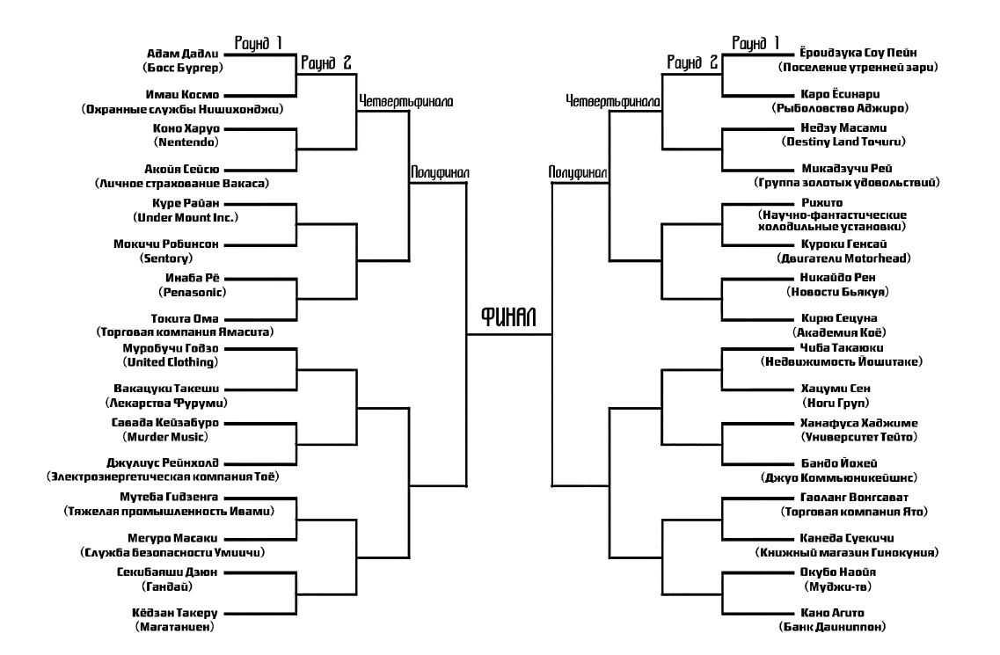
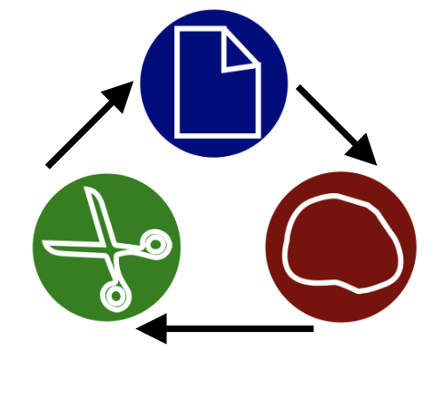
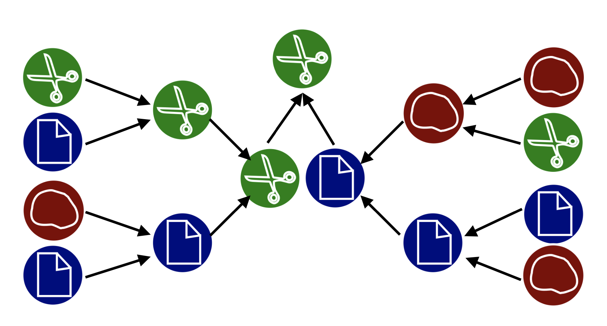
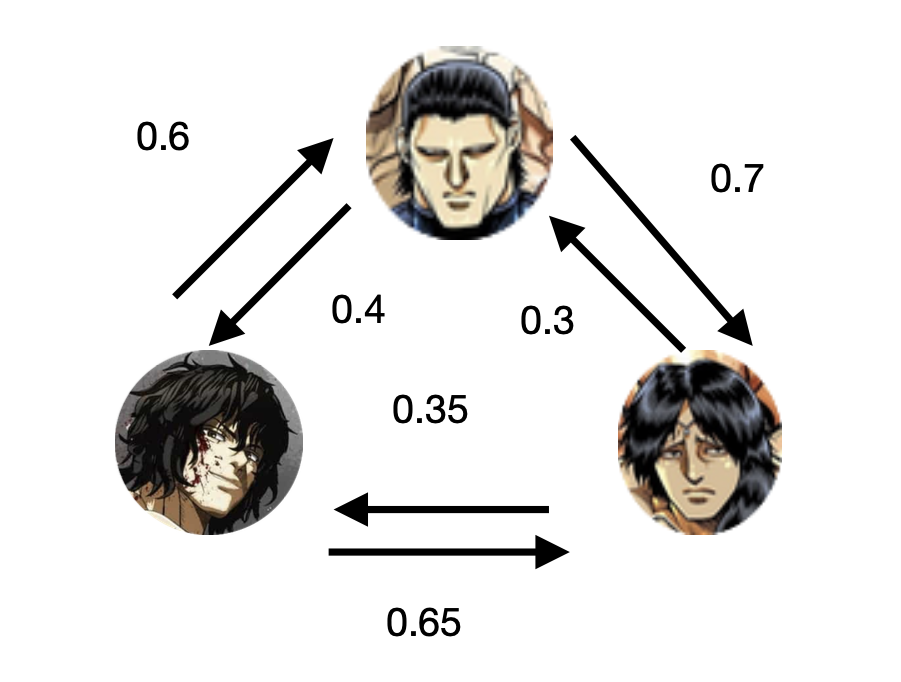

Как-то раз смотрел я (автор темы) один японский мультфильм — Kengan Ashura. Сюжет его крутится вокруг турнира по боевым искусствам, на котором крупнейшие корпорации Японии выставляют своих бойцов, решая деловые споры на арене. Конкретно на том турнире должны были определить, грубо говоря, самую авторитетную корпорацию, которая получит рычаги управления экономикой страны до следующего турнира.

## Задание

В мультфильме перед началом боев главы корпораций тянули жребий и выбирали по очереди место их бойца в турнирной сетке. Вам предлагается попробовать себя в роли владельца корпорации и попытаться оптимально выбрать место для вашего бойца.

## Комментарии

Для определения сильнейшего правильно было бы устроить бой каждого с каждым и посчитать количество побед участников, но проигравшие бойцы часто приходят в негодность уже после одного боя (да и победителям достается), так что едва ли такая схема подходит для бойцовского турнира. Вместо нее используют так называемую турнирную сетку — более простой граф поединков, где проигравший выбывает, а победитель проходит в следующий тур. Турнирная сетка из мультфильма/манги выглядит следующим образом (щелкните на картинку, чтобы рассмотреть):

При такой схеме турнира сильнейший определяется по транзитивности. Если, мол, Б победил А, а В победил Б, то В также сильнее А. Но что если ситуация больше похожа на игру в камень-ножницы-бумага?

Скажем, есть у нас следующая схема турнира:

Можно ли сказать, что ножницы из левого верхнего угла — сильнейшие? Едва ли. Да этим ножницам просто повезло с турнирной сеткой! То есть расположение бойца в сетке имеет большое значение.

В мультфильме перед началом боев главы корпораций тянули жребий и выбирали по очереди место их бойца в турнирной сетке. Вам предлагается попробовать себя в роли владельца корпорации и попытаться оптимально выбрать место для вашего бойца. Как? Основываясь на интуитивных представлениях о сильных и слабых сторонах вашего бойца и его соперников. Эти интуитивные представления предлагается формализовать в виде ориентированного графа с вершинами-бойцами и взвешенными ребрами, веса которых отражают вашу веру в победу того или иного бойца, если между ними произойдет поединок. Граф для трех бойцов может выглядеть так:

Имея заполненную турнирную сетку и граф с вероятностями победы в возможных поединках, можно аналитически вычислить вероятность победы вашего бойца в турнире. Допустим, вы, господин/госпожа президент, выбираете место для своего бойца 15м/15ой. Как выбрать место? Предлагается для каждого из оставшихся пустых 18ти мест перебрать все варианты возможного развития турнира, если вы поставите своего бойца на это место, и выбрать то место, для которого средняя вероятность победы вашего бойца в турнире будет наибольшей. Слишком много вариантов для перебора в уме или на бумаге? Тогда почему бы не воспользоваться компьютером? Только учтите в ваших расчетах, что главы других корпораций тоже хотят победить и выбирают места для своих бойцов не случайным образом, а применяют похожую стратегию.

### Литература

 Общая литература по теории вероятностей и методу Монте Карло:

Ширяев А.Н., Вероятность-1, МЦНМО, 2011, 552 стр.

Reuven Y. Rubinstein, Dirk P. Kroese, Simulation and the Monte Carlo Method, Third Edition, Wiley Series in Probability and Statistics, 2016

### Баллы

 1 курс – 100, 2 курс – 50.

(100 баллов на 1 курсе означает, что работа целиком делается за два семестра, с зачетом в каждом из них. Есть возможность заработать 50 баллов, получить зачет и дальше не продолжать (хотя ведь интересно же)).

## Руководитель

 Гученко Роман Александрович