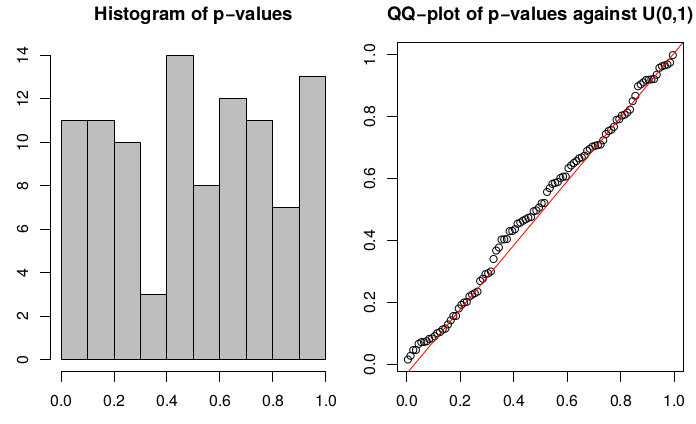
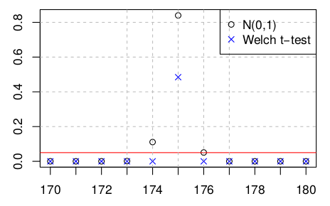
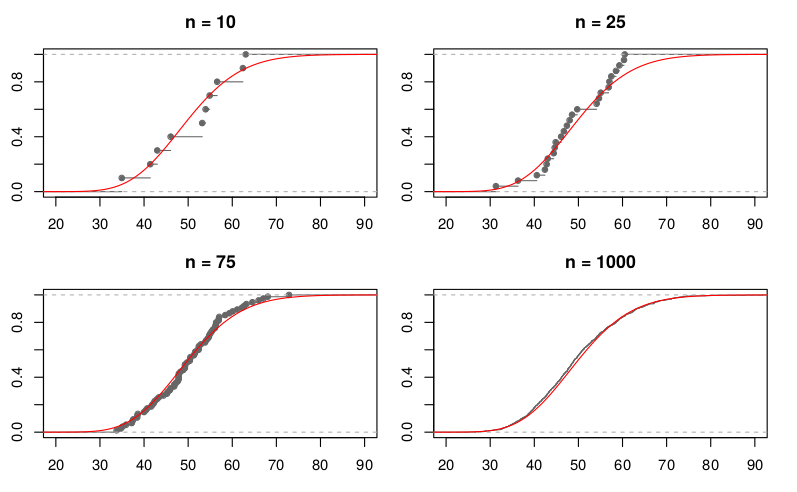

## Мотивировка

В R есть три системы построения графиков: base graphics, lattice и ggplot2. Среди них невозможно выделить однозначно лучшую. Так, функции base graphics, несмотря на возраст и некоторую негибкость, удобно использовать, чтобы нарисовать что-нибудь на лету в интерактивной сессии R; пакет lattice удобен для представления сразу нескольких графиков на одном изображении, но менее универсален. ggplot2 относительно молод, универсален, предоставляет адекватные настройки по умолчанию, гибок, хорошо вписывается в систему пакетов “tidyverse”.

Если студент планирует в будущем заниматься статистикой, высока вероятность, что придется строить приличное количество графиков, в том числе, для квалификационных работ и сопутствующих презентаций. Предлагается, поэтому, освоиться с ggplot2, а также научиться правильно экспортировать полученные результаты так, чтобы они прилично смотрелись в документах и/или на слайдах.

## Задание

Почитать про layered grammar of graphics, познакомиться с видами статистических графиков, понять, как ПРАВИЛЬНО рендерить результат для вставки в TeX-документ так, чтобы использовался шрифт документа, а в самом графике рисовались бы произвольные TeX-формулы. Результатом задания является 5 графиков, сделанных по запросу руководителя.

## Баллы

2 курс – 15 баллов, 1 курс – 30 баллов.

## Необходимые навыки и подготовка

- Английский на уровне комфортного чтения технических статей.
- Понимать основы TeX. Информацию по TeX можно найти [здесь](http://statmod.ru/wiki/study:fall2017:tex).
- Желательно знать, что такое распределение вероятностей (в т.ч. нормальное распределение), функция плотности, гистограмма, среднее.

## Часть 1

Ознакомиться с ggplot2.

- Теория построения графиков ggplot2 описывается т.н. “layered grammar of graphics”, с которой можно ознакомиться по [соответствующей статье](http://byrneslab.net/classes/biol607/readings/wickham_layered-grammar.pdf).
- Отличное введение ggplot2 можно прочитать [здесь](http://r4ds.had.co.nz/data-visualisation.html).
- Для более детального ознакомления подойдет книга [ggplot2: Elegant Graphics for Data Analysis](../assets/research/wickham_--_ggplot2_elegant_graphics_for_data_analysis.pdf).
- Примеры графиков: [1](http://www.sthda.com/english/wiki/be-awesome-in-ggplot2-a-practical-guide-to-be-highly-effective-r-software-and-data-visualization), [2](http://r-statistics.co/Top50-Ggplot2-Visualizations-MasterList-R-Code.html).
- [Референс по ggplot2](https://ggplot2.tidyverse.org/reference/)

## Часть 2

Научиться правильно экспортировать графики.

Графические форматы бывают растровые (png, jpg, …) и векторные (svg, …). Растровые изображения смотрятся в документах ужасно: их нельзя увеличивать без потери качества, текст на графике не является текстом документа, на график нельзя помещать произвольные TeX-вставки. Векторные изображения смотрятся лучше, однако не всегда оказывается тривиально подобрать подходящие шрифты и определить корректный размер картинки, чтобы она не смотрелась слишком большой или слишком маленькой.

Единственно приемлемый вариант, поэтому, это конвертировать изображение в его описание на векторном языке TikZ, которое затем переводится в картинку при рендеринге TeX документа. Плюсом такого метода является возможность включения произвольных TeX вставок в изображение, а также шрифты, которые смотрятся “как родные” в документе. Чтобы разобраться с таким экспортом, необходимо прочитать справку по `tikzDevice` в R. Остается проблема корректного задания размера графика. Можно подумать самостоятельно, а, при отсутствии идей, обратиться к руководителю за помощью.

Про TikZ почитайте где-нибудь самостоятельно, пожалуйста.

## Часть 3

Построить 5 графиков.

Названия графиков в скобочках приведены в качестве необязательной справки.

Для всех графиков следует использовать тему `theme_bw` и 10-й размер шрифта для подписей к осям и легенды.

### 1. Скаттерплот (“состоятельность выборочного среднего”)

**Данные** \$N\$ выборок из нормального распределения (\$\mu\$ = 0, \$\sigma^2\$ = 100) объема, соответственно, от 1 до \$N\$. Для каждой выборки посчитать её выборочное среднее. В качестве \$N\$ можно выбрать, например, 500 или 1000 – что окажется нагляднее

Можно адаптировать следующий код:

      library(tidyverse)
      set.seed(1)
      mu <- 0
      sd <- 10
      N <- 1000
      means <- 1:N %>%
        map(rnorm, sd = sd, mean = mu) %>% 
        map_dbl(mean) %>% 
        enframe(name = 'n', value = 'mean')

**График** Скаттерплот средних (ось ординат) против объема соответствующей выборки (ось абсцисс). Через \$y = 0\$ провести горизонтальную прямую красного цвета.

Точечки: поэкспериментируйте с размером, цветом, заливкой, чтобы было красиво.

Подписи к осям:

- Объем выборки (\$n\$)
- Выборочное среднее (\$\bar{\mathbf{x}}\_{n}\$)

Легенда:

- Для горизонтальной прямой: \$\mu = 0\$

### 2. График функции (“плотность стандартного нормального распределения”)

**График** Нарисовать график функции `dnorm` с параметрами по умолчанию (“плотность стандартного нормального распределения”).

Оси:

- \$x\$ от \$-4\$ до 4
- \$y\$ по умолчанию

Не рисовать тики на осях. Не подписывать оси. Если получится, не рисовать ось \$y\$ вовсе.

Закрасить область под графиком в интервалах \$(-\infty, -2)\$ и \$(2, \infty)\$. Точки \$x=-2\$, \$x=2\$ подписать, соответственно, \$-\|T(\mathbf{x})\|\$ и \$\|T(\mathbf{x})\|\$.

Легенда:

- Закрашенная область: \$p\$-value
- Кривая графика: \$\mathrm{pdf}\_{T\mid H\_{0}}(x)\$

### 3. Гистограмма и QQ-plot (“равномерное распределение p-values”)

**Данные** Прогнать следующий код, получить тиббл `pvalues`.

      library(tidyverse)
      set.seed(1)
      sigma0 <- 1
      mu0 <- 0
      n <- 100
      N <- 100
      z <- function(xx) sqrt(length(xx)) * (mean(xx) - mu0) / sigma0
      pv <- function(z) 2*(1 - pnorm(abs(z)))
      pvalues <- replicate(N, rnorm(n), FALSE) %>% 
        map_dbl(z) %>% 
        map_dbl(pv) %>% 
        tibble(pv = .)

**График** Нарисовать два графика в одном: гистограмму `pvalues$pv` и т.н. QQ-plot. Чтобы не вдаваться в статистические детали, QQ-plot нарисуйте, пожалуйста, таким вызовом:

      ggplot(pvalues, aes(sample = pv)) +
        stat_qq(distribution = qunif) + 
        stat_qq_line(distribution = qunif)

Для гистограммы поэкспериментировать с количеством бинов-столбиков, чтобы выглядело наглядно. Сами бины должны быть с серой заливкой, черными контурами, прозрачностью 0.4 и толщиной линии 0.2.

Должно получиться что-то вроде следующего графика (только красивее):

### 4. Скаттерплот двух категорий (“p-value t-критерия с нормальным распределением и t-критерия Welch’а”)

**Данные** Используйте следующий код, чтобы получить тиббл `pvalues`.

      library(tidyverse)
      set.seed(1)
      n1 <- 1000
      n2 <- 1000
      pvs.norm <- rep(0, 11)
      pvs.welch <- rep(0, 11)
      
      for (mu in 170:180) {
        boys <- rnorm(n1, 175, 5)
        girls <- rnorm(n2, mu, 3)
        t <-  (mean(boys) - mean(girls)) /
              sqrt(
                (var(boys) * (n1 - 1) / n1)^2 / n1^1 +
                (var(girls) * (n2 - 1) / n2)^2 / n2^1
              )
        pvs.norm[mu - 169] <- (1 - pnorm(abs(t))) * 2
        t <- t.test(
          boys,
          girls, 
          "two.sided",
          var.equal = FALSE,
          paired = FALSE
        )
        pvs.welch[mu - 169] <- t$p.value
      }
      
      pvalues <- tibble(
        height = rep(170:180, 2),
        pv = c(pvs.norm, pvs.welch),
        type = c(rep('norm', 11), rep('welch', 11))
      )

**График** Нарисовать скаттерплот `pvalues$pv` против `pvalues$height`, используя `pvalues$type` в качестве индикатора категории значения. Каждую категорию нарисовать по-своему на графике: цветом и/или видом символа.

Должно получиться что-то похожее на следующий график:

Оси, легенду и всё остальное оформить самостоятельно по образу и подобию графика выше. Красная горизонтальная линия – на уровне \$y=0.05\$

### 5. Грид из четырех графиков-эмпирических функций распределения (“демонстрация теоремы Гливенко–Кантелли”)

Воспроизведите следующий график:

Здесь изображены эмпирические функции распределения выборок соответствующих объемов из \$\chi^2(50)\$ (`rchisq(n, 50)`) и настоящая функция распределения \$\chi^2(50)\$. Вам понадобится функция [stat_ecdf](https://ggplot2.tidyverse.org/reference/stat_ecdf.html).

Добавьте легенду.

## Руководитель

Зотиков Дмитрий
