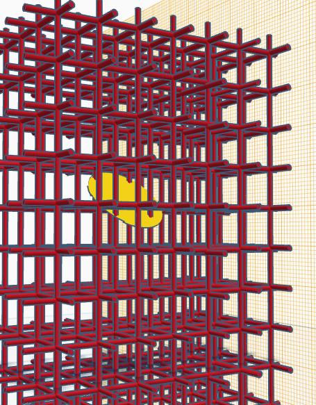
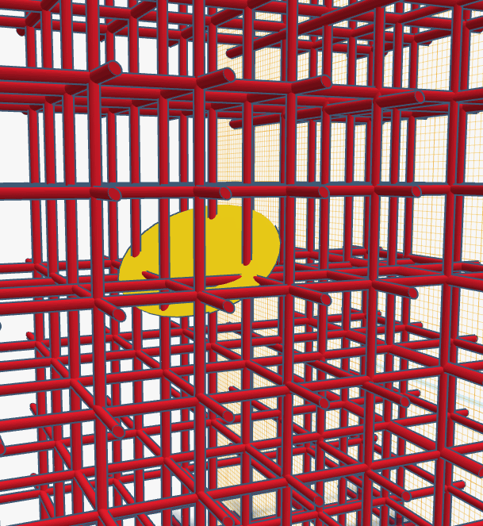
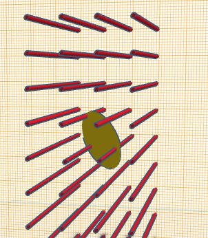
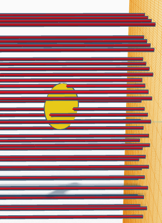

## Условие

Грабитель банка попал в ловушку. При попытке выноса ценностей из хранилища сработала охранная система и единственный коридор по которому можно выбраться перегородила трехмерная решетка из невидимых невооруженному глазу периодически возникающих инфракрасных лучей (с периодичностью 0.5 сек. с продолжительностью 0.00001 сек). При пересечении любого из лучей физическим объектом срабатывает система сверхмощных лазеров (лучи, которые пересек объект, становятся лазерными(и видимыми) на 0.1 сек.). Мощности лазеров хватит, чтобы разрезать человека на части. На первый взгляд, ситуация безвыходная. Однако, еще не все потеряно. В хранилище есть терминал, с которого можно ввести код, отключающий охранную систему. Код восьмизначный. К счастью для грабителя, охранную систему разрабатывал его бывший одногруппник, выпускник кафедры статистического моделирования. Тот как-то похвастался, что придумал код, который невозможно забыть: среднее число пересечений лучей при случайном размещении (и фиксации) произвольно ориентированной монеты в произвольном месте внутренней области решетки (в качестве кода берутся 8 цифр этого числа без учета разделяющего знака). Однако, в свое время, грабителя отчислили с мат-меха, потому что он не смог сдать зачет по моделированию на 3-м курсе. Хватит ли ему тех знаний, что он приобрел на 1-2 курсах, чтобы найти ответ?

## Доп. данные

Размеры решетки 3x3x6 метров. Диаметр монеты 1 см. Каждая ячейка решетки образует куб с длинной грани 0.5 см. Расстояние от нижней ячейки решетки до пола: 1.1 см. Толщиной монеты можно пренебречь. Количество монет в хранилище - более 100 тыс. Инфракрасные лучи возникают через каждые 0.5 секунды на 0.00001 сек. Таким образом, если, например, монета находится в области 1.4 секунды, то она может попасть в пересечение лучей 2 или 3 раза. (Число пересеченных лучей в момент попадания зависит от ориентации монеты). Каждое попадание можно рассматривать как отдельный эксперимент. Считаем, что монету лазеры не разрезают.

!!! tip

    Задачу можно решить как методами статистического моделирования, так и используя классическую теорию вероятности. Доступа в интернет у грабителя нет.

### Подсказка

Для решения задачи с помощью статистического моделирования достаточно написать функцию, позволяющую посчитать, сколько лучей пересечет монета, размещенная во внутренней области решетки при заданных углах поворота и фиксированных координатах центра. Далее эту функцию нужно запустить N раз для случайных углов поворота и координат центра, после чего поделить общее число пересечений на N.

!!! tip

    Суммарное количество баллов, которые можно получить за задания 1 - 5: не больше 50! 

    При решение одной и той же задачи двумя способами (аналитически и моделированием) баллы начисляются с корректирующим коэффициентом - 0.75.

    Например, за полное решение 3-й задачи первокурснику будет начислено 40*0.75= 30 баллов

### Задание 1

Найти среднее число пресечений монеты с лучами решетки (при каждом испытании произвольно ориентированная монета размещается случайным образом в произвольном месте внутренней области решетки (т.е. считаем, что монета всегда остается внутри области)).

#### Баллы

Теоретическое решение: 2 курс – 25 баллов, 1 курс – 50 баллов.  
Решение с помощью моделирования: 2 курс – 15 баллов, 1 курс – 30 баллов.

 

### Задание 2

Оценить, хватит ли грабителю времени, чтобы сбежать из банка, если он попробует решить задачу с помощью физического моделирования (путем бросания монетки). Считаем, что при каждом броске монетка находится внутри решетки не более 2 сек. До открытия банка 6 часов.

#### Баллы

2 курс – 10 баллов, 1 курс – 20 баллов.

### Задание 3

Решаем ту же задачу, но вместо монетки используем шарик диаметра 1 см.

#### Баллы

Теоретическое решение: 2 курс – 10 баллов, 1 курс – 20 баллов.  
Решение с помощью моделирования: 2 курс – 10 баллов, 1 курс – 20 баллов.

!!! tip

    Баллы за задания 1 и 3 не суммируются!

### Задание 4

Решаем исходную задачу при уловии, что “решетка” состоит только из параллельных лучей.

 

#### Баллы

Теоретическое решение: 2 курс – 10 баллов, 1 курс – 20 баллов.  
Решение с помощью моделирования: 2 курс – 10 баллов, 1 курс – 20 баллов.

### Задание 5

Определить распределение вероятностей для монетки единичного радиуса размещаемой случайным образом на плоскости, расчерченной на единичные клетки. Т.е. посчитать вероятность того, что лежащая на плоскости монета покрывает 2, 3 или 4 вершины клетки.

#### Баллы

Теоретическое решение: 2 курс – 10 баллов, 1 курс – 20 баллов.  
Решение с помощью моделирования: 2 курс – 10 баллов, 1 курс – 20 баллов.

### Подготовка

Почитать про метод [Монте-Карло](https://ru.wikipedia.org/wiki/%D0%9C%D0%B5%D1%82%D0%BE%D0%B4_%D0%9C%D0%BE%D0%BD%D1%82%D0%B5-%D0%9A%D0%B0%D1%80%D0%BB%D0%BE). Посмотреть определение [вероятности](https://ru.wikipedia.org/wiki/%D0%92%D0%B5%D1%80%D0%BE%D1%8F%D1%82%D0%BD%D0%BE%D1%81%D1%82%D1%8C).

### Литература

Мостеллер Ф., Рурке Р., Томас Дж. Вероятность. «Мир», 1969 г.

Ермаков С.М., Михайлов Г.А. Статистическое моделирование. М.: ФИЗМАТЛИТ, 1982.

## Руководитель

Шпилев Петр Валерьевич
