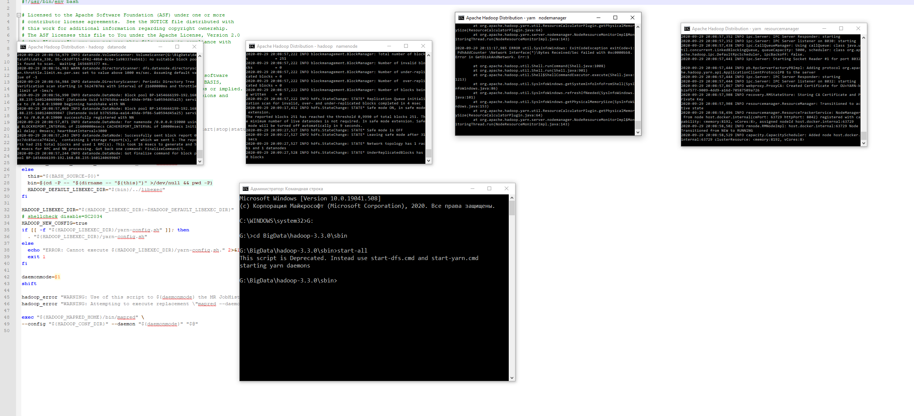
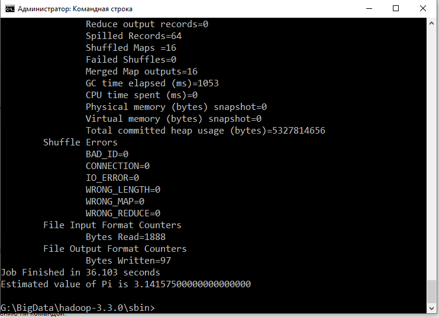

**Место и время проведения:** пятница, 17:00, дистанционно.  
**Преподаватели:** Гученко Роман Александрович  

### Устанавливаем ПО

Для занятий нам понадобятся Hadoop и Hive.  
Согласно опросу, Windows 10 - это выбор большинства, так что инструкция писалась с акцентом на Windows.

#### Hadoop

##### Windows 10

Вот неплохая инструкция (сам воспользовался именно ей):  
<https://kontext.tech/column/hadoop/447/install-hadoop-330-on-windows-10-step-by-step-guide>  
Установка Hadoop на Windows сопряжена с некоторыми нюансами.  
Обратите внимание, что нужно будет поставить native IO binary, которые не включены в комплект (шаг 3 в инструкции).  
Лучше скачать их напрямую с github’а по ссылке, а не через powershell как в инструкции (у меня он как-то умудрился их попортить при скачивании).  
Для работы winutils может потребоваться обновление visual c++ redistributable:  
<https://support.microsoft.com/ru-ru/help/2977003/the-latest-supported-visual-c-downloads>  
Для 64-битной операционки нужно будет поставить сразу vc_redist.x86.exe и vc_redist.x64.exe (а не только x64).

Есть более экзотический вариант с Windows Subsystem for Linux (для Windows 10 2004 есть WSL2, который должен работать быстро):  
<https://kontext.tech/column/hadoop/307/install-hadoop-320-on-windows-10-using-windows-subsystem-for-linux-wsl>  
Его я не пробовал.

Можно также попробовать через docker, но с ним на Windows сложности.

##### Linux

Официальная инструкция (не пробовал):  
<https://hadoop.apache.org/docs/stable/hadoop-project-dist/hadoop-common/SingleCluster.html>

##### Mac

Не сильно отличается от варианта на Linux.  
Проще всего ставить через brew install.  
Например (пробовал):  
https://medium.com/beeranddiapers/installing-hadoop-on-mac-a9a3649dbc4d  
Настройки (core-site.xml, hdfs-site.xml, mapred-site.xml, yarn-site.xml) лучше взять из официальной инструкции для Linux.

##### Проверка установки

Пример для Windows.  
Запустите консоль (cmd в поиске “Пуска”) от имени администратора и перейдите в %HADOOP_HOME%\sbin.  
Введите start-all и нажмите Enter.  
Запустятся четыре других окошка консоли и в них побегут буковки.  

Нужно подождать, пока буковки перестанут бежать во всех четырех окошках.  
Nodemanager может выдавать что-то типа:  
2020-09-28 00:36:35,309 ERROR util.SysInfoWindows: ExitCodeException exitCode=1: PdhAddCounter \Network Interface(*)\Bytes Received/Sec failed with 0xc0000bb8.  
Это значит, что у вас стоит неанглийская версия Windows.

Теперь попробуйте запустить пример по вычислению пи командой:  
yarn jar G:\BigData\hadoop-3.3.0\share\hadoop\mapreduce\hadoop-mapreduce-examples-3.3.0.jar pi 20 1000000  
(Не забудьте поменять путь до jar’ки с примерами)

Консоль должна прийти в движение.  
Если через некоторое время вы увидели на экране “Estimated value of Pi is…”, значит все в порядке.

Можете также зайти через браузер в jobtracker на  
<http://localhost:8088/cluster/apps/RUNNING>  
и проследить за процессом вычисления пи с точки зрения созданного вами one-node кластера.

#### Hive

##### Windows 10

Еще одна хорошая инструкция:  
<https://kontext.tech/column/hadoop/459/apache-hive-312-installation-on-windows-10>  
Тут, вроде как, особых подводных камней быть не должно.  
Если вы не умеете пользоваться vi (как я), то отредактируйте .bashrc в пункте “Setup environment variables” через какой-нибудь другой редактор.  
У меня этот файл лежит в папке G:\cygwin64\home\Roman.  
Чтобы explorer его видел, не забудьте включить показ скрытых файлов.  
Пропустите пункт “Configure a remote database as metastore” и пункт “Start HiveServer2 service”.  
В пункте “Run CLI directly” в Cygwin введите просто hive.  
Собственно, должен запуститься hive.  
Дальше проверьте его по инструкции, создав тестовую таблицу.  
Если все в порядке, этот процесс создания таблицы должен отобразиться в jobtracker’е.

##### Linux

Не пробовал:  
<https://www.edureka.co/blog/apache-hive-installation-on-ubuntu>

##### Mac

<https://dbmstutorials.com/hive/hive-setup-on-mac.html>

В качестве базы для метаданных предлагаю использовать derby (как и в других инструкциях).

#### Cloudera Quickstart VM

Если все тщетно и установить Hadoop с Hive’ом не получается (или если просто лень), то на помощь придет Cloudera Quickstart VM.

Вот ссылка на образ для VirtualBox:  
<https://downloads.cloudera.com/demo_vm/virtualbox/cloudera-quickstart-vm-5.13.0-0-virtualbox.zip>

И ссылка на сам VirtualBox:  
<https://www.virtualbox.org/wiki/Downloads>

Кластер, конечно, получится довольно немощным (с ограничением в 1 поток и 4gb оперативной памяти по умолчанию), но зато не нужно будет ничего настраивать.

Проблема в том, что Cloudera Quickstart VM уже не поддерживается и ссылка на официальный сайт уже не очень официальная…

#### Google Cloud

Здесь, возможно, появится инструкция по пользованию пробной версией dataproc на Google Cloud.

#### glogg

Как бонус, можно установить glogg - программу для чтения больших файлов.

Ссылка:  
<https://glogg.bonnefon.org/download.html>

Обычно текстовые редакторы (скажем, notepad++ или sublime) загружают файлы в оперативную память целиком.

Если файл весит хотябы несколько гигабайт, то это для них уже проблема.

glogg же индексирует файл при открытии и загружает в память по кусочкам.

Правда редактировать их он не позволяет.

### Темы занятий
